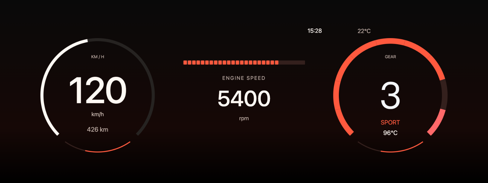

# Glass Cluster Sport — 预览

参考阿斯顿·马丁 CarPlay Ultra 双圆环布局的运动版设计：放大车速与档位示意，加粗转速环，中央展示转速和分段条。它是自定义设计，不是 Apple 官方运动模式。

按 `../glass-cluster/README.md` 启动预览服务后，打开：
http://127.0.0.1:18766/themes/glass-cluster/preview.html?layout=sport

截图的 120 km/h、5400 rpm、3 档均为模拟数据；右侧原厂档位由预览程序单独示意，不写入主题。7000 rpm 量程和红色区域未经本车校准，不作为换挡提示；未部署到车辆。
