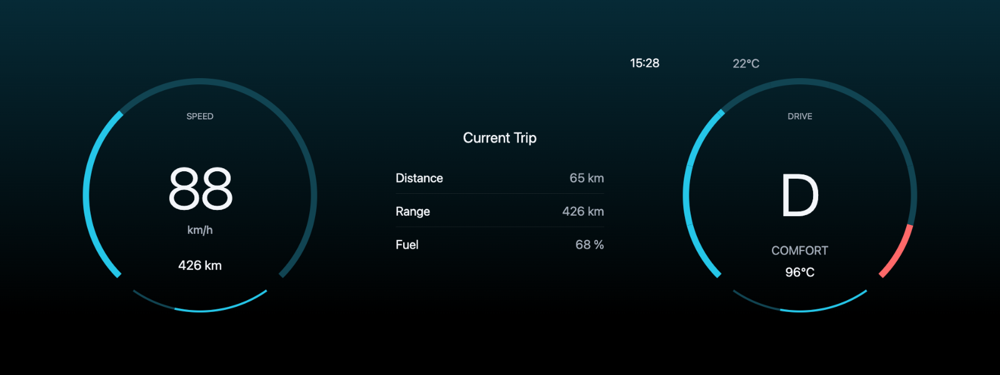

# Glass Cluster 0.2.0

参考苹果官方展示的阿斯顿·马丁 CarPlay Ultra：左右双圆环、左侧数字车速、右侧档位区域、中央行程列表、底部辅助弧线及深蓝背景。保留 Graphite、Sport、Eco 三套配色。

参考：[苹果官方展示](https://www.apple.com/newsroom/2025/05/carplay-ultra-the-next-generation-of-carplay-begins-rolling-out-today/)中的蓝色细圆环主题，以及灰色粗圆环主题的中央行程布局。参考照片未复制进项目。




## 预览

在仓库根目录执行：

```sh
npm ci --ignore-scripts
npm run build
npx vite --host 127.0.0.1 --port 18766
```

打开 http://127.0.0.1:18766/themes/glass-cluster/preview.html 。支持调整速度、转速、配色，查看原厂保留区和信号缺失状态。预览使用上游 Canvas 主题引擎和模拟数据；截图不代表实车效果。

主题文件可以在上游 Studio 中打开。这里没有修改 Studio 内置模板清单。

## 检查与编译

```sh
npx vitest run tests/glass-cluster.test.ts
npx tsx packages/theme-compiler/src/cli.ts validate themes/glass-cluster/theme.json
npx tsx packages/theme-compiler/src/cli.ts build themes/glass-cluster/theme.json --out dist/themes
```

## 实现边界

- 使用原生主题格式，无新增运行依赖；没有实时背景模糊。
- 使用上游显示配置的保留区；右侧圆环分成连续的小弧段，绘制边界避开原厂档位框，转速范围为 0–7000 rpm。
- 右侧 D 仅为浏览器模拟的原厂档位，可取消勾选隐藏；主题文件不绘制此区域。实车原厂档位的外观和位置仍需核实。
- 中央显示行程距离、续航和油量，没有接入 CarPlay 媒体、地图或高德导航转发。
- 文字暂用车端字库支持的英文。浏览器字体与车端字体可能存在差异。
- 已通过编译及自动检查，未上车验证。未修改现有车机主题、启动逻辑或配色持久化。
- GPL-3.0-or-later，基于 ALMSTRA/idv7lol；非 Apple 或 BMW 官方产品。
