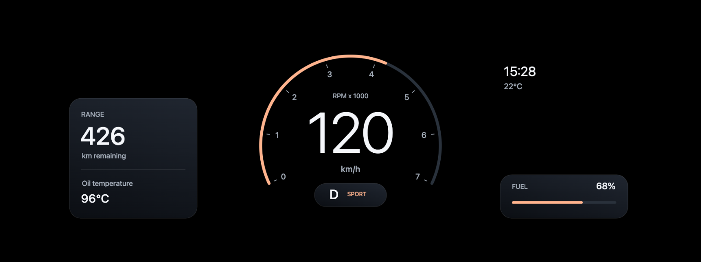

# Glass Cluster 0.1.0

面向 iDrive 7 的 CarPlay 风格原创主题。中央大号车速、细转速环，灰黑渐变信息卡片；三套配色随驾驶模式切换，也可手动选择。




## 预览

在仓库根目录执行：

```sh
npm ci --ignore-scripts
npm run build
npx vite --host 127.0.0.1 --port 18766
```

打开 http://127.0.0.1:18766/themes/glass-cluster/preview.html 。支持调整速度、转速、配色，查看原厂保留区和信号缺失状态。预览使用上游 Canvas 主题引擎和模拟数据；截图不代表实车效果。

主题文件可以在上游 Studio 中打开。这里没有修改 Studio 内置模板清单。

## 检查与编译

```sh
npx vitest run tests/glass-cluster.test.ts
npx tsx packages/theme-compiler/src/cli.ts validate themes/glass-cluster/theme.json
npx tsx packages/theme-compiler/src/cli.ts build themes/glass-cluster/theme.json --out dist/themes
```

## 实现边界

- 使用原生主题格式，无新增运行依赖；玻璃质感通过渐变、圆角和描边实现，没有实时背景模糊。
- 使用上游显示配置的保留区；右侧中央留给原厂档位显示，实车位置仍需核实。
- 本版中央被车速占用，不提供地图窗口或高德导航转发。
- 文字暂用车端字库支持的英文。浏览器字体与车端字体可能存在差异。
- 已通过编译及自动检查，未上车验证。未修改现有车机主题、启动逻辑或配色持久化。
- GPL-3.0-or-later，基于 ALMSTRA/idv7lol；非 Apple 或 BMW 官方产品。
